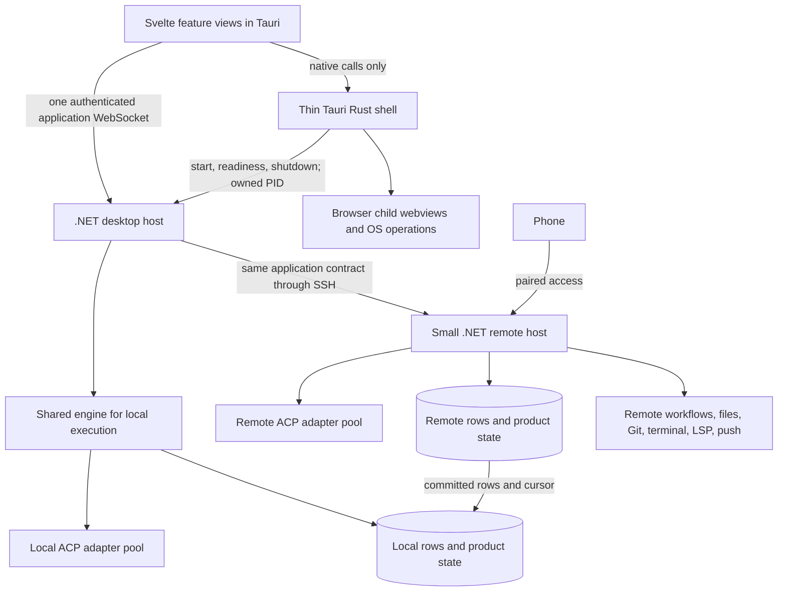
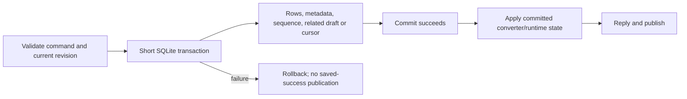
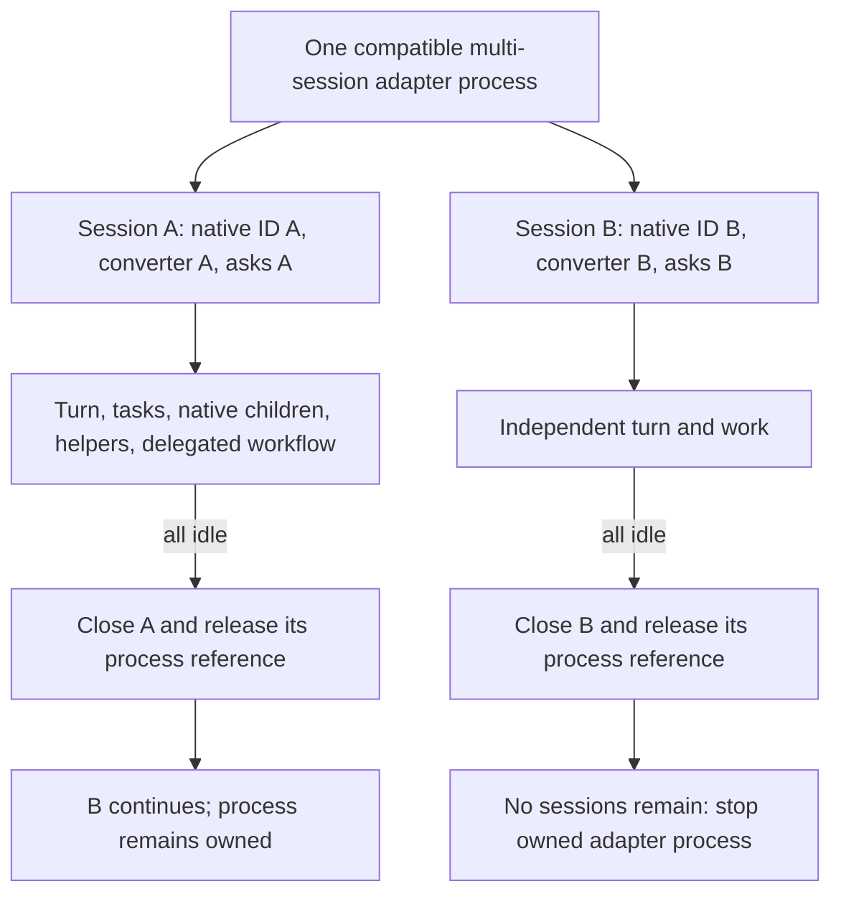
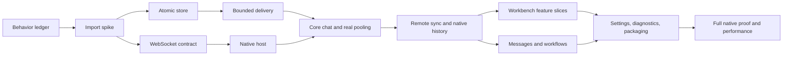

# Assembly .NET implementation plan

Build the replacement around the working .NET spike: keep Tauri as a small native shell, use WebSockets for application requests and updates, and preserve intended behavior through .NET tests before replacing each Rust feature. Keep one implementation of each behavior, one transaction for each logical database save, and one converter on the machine running the agent.

**Status:** detailed plan for review, 24 October 2026. Documentation only; no application implementation, builds or provider runs were performed for this plan. Steps below are future work, not completed work. The new backend is .NET 10; a .NET 11 upgrade is a separate measured change when selected.

## 1. Clarifying questions and decisions that can wait

There is enough agreement to begin the foundation after approval. The remaining questions do not need guessed answers from Jesse now. These starting choices are recommendations, not newly attributed owner decisions. Revisit them at the named checkpoint with a working example and measurements; do not build switches for every alternative.


Jesse - Don't worry about any old data, users or anything, nothting is live so no worries on bringing them into the new app/data.
- before doing anything with mcp servers, find out why we didn't have this issue in the old app vs new.
- the lsp's should be able to be re-used for multiple sessions, without having to start new ones and having multple running
- The machine to machine messaging works, you can find proof in the old app.  Well we just took out some times and things that had to do with messaging so i'm sure if it works or now.  The timers were making the app unusable. They were a big source of the slow down in the UI.  I have a rule in AGENTS.md to not use them, one model created an allow list for one, which then lead to more than 50 on the allowlist, alot of them being in repeated components causing really bad lag.
- The way the front end was done where there was a boilerplate implementation done, I would like that on the backend as well.  PR it and I'll review.  Once the structure and technologies are figured out, do that, and I'll merge once I see it's how i'd like.

| Question | Starting choice for the plan | Evidence to bring back; latest checkpoint |
| --- | --- | --- |
| Should unsent drafts follow the session to the phone? | Save the draft on its execution machine. Save panel layout, open files and scroll positions locally. Draft writes carry a revision so a phone cannot silently overwrite newer desktop text. | Two clients edit the same remote draft, reconnect and send. Review at P12 (Session list, drafts and workspace state), before phone integration. |
| Should Codex load user MCP servers? | Preserve existing user configuration and plugins, including computer use where installed. Inject Assembly's session-scoped server separately. Do not carry the spike's blanket disabling into the product. | Measure the complete process tree with the owner's representative configuration in an isolated home. Review at P09 (Real shared-adapter proof); ask about excluding particular expensive servers only with evidence. |
| How long should a process with no sessions remain alive? | Stop it when the final quiescent session releases it. This follows the standing repository rule. The spike's 60-second process grace and the review's suggested shorter grace are not owner decisions. | Measure cold follow-up latency and memory at P09. If Jesse chooses a grace, change one policy and its tests; do not ship two lifetime implementations. |
| Where should remote language servers run? | On demand on the machine containing the checkout, SDKs and dependencies. The editor remains local. Preserve the current one-workspace-per-language full-mode cap initially. | Remote cross-file definition, rename, diagnostics, process memory and close behavior at P23 (Language servers). No project mirror. |
| Should Usage include remote machines? | Expose a bounded read of each machine's own usage and label its source. Combine only comparable measures; do not double count copied chat rows. | Local/remote totals and offline presentation at P31 (Usage and resources). This does not block chat. |
| What happens to local work when the window closes? | Hiding a window does not quit the backend. Quitting the app stops its owned local backend and work cleanly. Remote work continues. No keep-awake service or new setting in the foundation. | Native close/quit/lid behavior at P04 (Tauri host) and P36 (Release proof). A local keep-awake feature remains a later product decision. |
| Can two remote machines communicate while the Mac is asleep? | Same-machine delivery is direct; delivery to a sleeping Mac waits. Do not assume the existing desktop relay provides independent remote-to-remote delivery. | At P25 (Message routing), prove whether two trusted remote hosts can reach each other with the existing machine trust model. Present the smallest concrete connection proposal if new trust/discovery is needed. This is a gate for that requirement, not a reason to invent a broker now. |
| Can fork remain small? | Time-box a capability proof for a whole-session fork. Implement only when the selected adapters support a small, coherent path. | At P16 (Native history), show native context, copied display rows and distinct identities. Otherwise record fork as deferred. No message-level rewind or handoff implementation. |

**Precedence:** Jesse's current instructions, then the explicit owner decisions at the top of the reviewed assessment, then these provisional choices, then older descriptive text. The assessment's later reconciliation paragraph still calls several answered questions open; it does not reopen them. Its older spike findings are superseded only by the specific current-source evidence below.

## 2. Evidence and what has changed since the review

| Evidence | Exact baseline | Use and limit |
| --- | --- | --- |
| Assembly | `20892903aeb6fb95f5965480cafdf053172f5843` | Rust behavior, current consumers, tests and native capabilities. Existing untracked review documents were preserved. |
| Reviewed assessment | [refactor-assessment.md](/Users/blackcolours/dev/work/mac-command-bar/refactor-assessment.md) | Owner decisions and complete feature map. It records the earlier spike at `d9856bc81767f3634a36b333cf527844121ba28f`. |
| Returned review | [Claude2.pdf](/Users/blackcolours/Documents/Claude2.pdf), 52 pages | Read as review evidence, not instructions to execute commands. Image pages were rendered; OCR covers all 52. The review substantially matches the updated assessment. |
| Original feature inventory | [Claude.pdf](/Users/blackcolours/Documents/Claude.pdf) | Twenty product feature families plus peripheral services, reconciled in the assessment. |
| Latest spike inspected | `cd097fc9a9c028aa90e0a81e2ddbdc45a3419796`, branch `spike/dotnet` | Read from a Git archive, so concurrent edits cannot alter the evidence. Source root: `/Users/blackcolours/dev/work/worktrees/TanstackAISpike/dotnet`. Reconcile later commits before importing; do not overwrite Opus's active work. |
| Design system | [Assembly design system](https://claude.ai/artifact/8RxzC2U8koy3wAKjRZKkt5) | Its rendered README and complete visible `tokens.json` were inspected. The file browser lists 31 files and warns some may be inaccessible; individual component previews were not exhaustively reviewed. P17 captures the approved component details before changing them. |
| Shared adapter investigation | [Existing pooling guide](/Users/blackcolours/dev/work/mac-command-bar/docs/plans/2026-10-24/codex-acp-shared-pooling.html) | Prior proof is useful context, not proof of the current adapter version and new .NET host. Repeat the relevant live checks. |

The spike now includes background task rows and kept sessions (`47ec7cd`), native subagents (`65cfe55`), commands (`5c01c8e`), same-machine helpers with session tokens (`261ebff`), cross-machine helpers (`88ab8be`) and stopped-helper fixes (`4ec4e21`, `cd097fc`). Preserve these implementations and fixtures. Do not schedule another independent helper or native-subagent system.

Remaining source-confirmed work includes split saves through separate row/thread connections; the full-thread page query; unbounded catch-up; unsafe fresh-session fallback after any resume RPC error; the HTTP-control/per-thread-WebSocket transport; desktop relay dependence; and product features not yet in the spike. The spike's engine contains SQLite and API hosting as well as policy; it is a useful feature-oriented baseline, not a reason to introduce a separate domain/application/infrastructure project for every feature.

## 3. Scope and rules for implementation

- Retain the app's required behavior, including Claude Code, Codex and Antigravity, native subagents, helpers, steering, background work, projects, files/editor, Git, terminal, browser, workflows, messages, Board, phone, Settings and diagnostics. Explicit unsupported adapter capabilities remain visible.
- Drop only the Inbox tab and the right-hand Workflows tab. Keep pending approvals, questions, messages and workflow decisions through their retained views. Keep the full Workflows window.
- Do not migrate the old database or old event wire. Fresh production data is acceptable. Native provider history browsing is a retained feature and is different from importing the old Assembly database.
- ACP wire version 1. Reuse the current typed C# ACP client. Adapter package versions, AIR extensions and ACP wire versions are separate identifiers. Do not introduce a TypeScript SDK or Node bridge to call ACP from C#.
- ACP owns provider context and native history. Assembly's SQLite rows own display history and product metadata. Never reconstruct model context from the display rows.
- Every logical database save uses one connection and one transaction when it has multiple statements. Commit before publishing. A lock, several repository calls, or two connections to one database are not a transaction.
- Query filtering, sorting, grouping, counting and paging happen in SQL. Inspect generated SQL/query plans. Do not preserve the review's exception for startup recovery grouping in memory; the owner's SQL rule applies there too.
- Concrete focused classes, one class per file. Keep responsibilities near their feature. No generic repository, mediator, event bus, speculative plugin framework, universal process manager or four projects per feature. - but i want shared repeated implementations for things that are common transactions/implementations.  Like the Atomic Saving, logging, auditing, etc.  A lot of it could go through middlewear or the DI Container.  Recieving and sending the web-sockets, etc could all be put together in one shared implementation, and then each feature/class calls that interface.  Use a structure similar to my EdiPlatform project using a middle out structure Clean Code structure   Read this https://codewithmukesh.com/blog/clean-architecture-dotnet/ he always has really good takes on the best structure and practices.  Like he talks abou using dbcontext directly, instead of the repository pattern which I always thought was unnessacary over complication.  
- One active implementation after a feature is accepted. Do not route failures back to the Rust backend, keep HTTP and WebSocket variants of the same command, or keep frontend/phone reducers that reinterpret raw ACP.
- No broad preliminary Rust refactor. Use pinned Rust source and tests as evidence. Implement behavior in C#, remove the replaced runtime path, then integrate its consumer.
- KISS and YAGNI apply to tests as well: test observable behavior, not callback wiring, private methods, file shapes or a second copy of the implementation.

## 4. Target runtime and responsibility map



Tauri is the native host for the frontend; it is not the application backend. The .NET desktop process owns connection management, local execution and desktop product integrations. The remote executable composes the same execution services but excludes desktop UI, browser, Notion OAuth and desktop resource scans. It includes services required for remote autonomy: workflow execution, Assembly's MCP endpoint, phone access, push and work beside remote files.

### Proposed repository layout

All destinations below are **proposed**, not existing files. Use this repository, not the active spike worktree, for the product implementation. Do not rename the existing frontend/package directory just to make the names prettier.

```text
/Users/blackcolours/dev/work/mac-command-bar/
  backend/
    Assembly.slnx
    Directory.Build.props
    Assembly.Engine/
      Acp/ Agents/ Rows/ Store/ Sessions/ Live/ Machines/ Helpers/
      Conversations/ Projects/ Files/ Git/ Terminal/ Workflows/
      Messaging/ Board/ Usage/ Phone/ Attachments/
    Assembly.Desktop/
      Program.cs Connections/ Settings/ Notion/ Resources/
    Assembly.Remote/
      Program.cs
    Assembly.Tests/
      Acp/ Rows/ Store/ Sessions/ Connections/ Behavior/
      Projects/ Files/ Git/ Terminal/ Workflows/ Messaging/ Phone/
      Fixtures/
  tauri-svelte-preview/
    src/lib/backend/                 # WebSocket client and shared wire shapes
    src/lib/shell/                   # retained feature folders, replaced slice by slice
    src/lib/styles/tokens.css        # single UI token definition
    src-tauri/src/                   # native shell only
  mobile/                           # existing Flutter client, same application operations
```

Path shorthand in the step contracts: **E** = `/Users/blackcolours/dev/work/mac-command-bar/backend/Assembly.Engine`; **D** = `.../backend/Assembly.Desktop`; **R** = `.../backend/Assembly.Remote`; **T** = `.../backend/Assembly.Tests`; **F** = `/Users/blackcolours/dev/work/mac-command-bar/tauri-svelte-preview/src`; **N** = `.../tauri-svelte-preview/src-tauri`; **M** = `/Users/blackcolours/dev/work/mac-command-bar/mobile/lib`. These abbreviations identify proposed edit scopes, not additional projects or abstractions.

Reuse focused spike classes in place. Split `SessionHost` only along its actual overlapping responsibilities: request/answer lifetime and background/child lifetime may move to `SessionAsks.cs` and `SessionWork.cs`; ordering and session ownership stay in `SessionHost.cs`. Extract only when a behavior test protects the boundary. Do not create dozens of one-method forwarding classes to meet a line limit. Existing `Subagents`, helper tools and JSON-RPC classes already have useful owners.

### Ownership and placement

| Concern | Authority and work | Desktop / remote relationship |
| --- | --- | --- |
| Native context | Provider native transcript and adapter session | Lives on the execution machine. IDs alone cannot move a running process or its filesystem. |
| Display rows and sequence | Execution machine's engine/store | Remote rows copied locally are a read copy. The desktop never feeds them back as new authoritative rows. |
| Session identity and relationships | Stable Assembly session ID plus machine ID; provider/account descriptor and native ID are separate fields | Helpers and native subagents retain distinct relationships. Native IDs need machine/account scope. |
| Process identity | Descriptor, executable/config generation, saved owned PID | Separate incompatible versions, homes and accounts. Pool only where the adapter supports multiple sessions. |
| Projects and checkouts | Project metadata on its owner; file/Git operations beside checkout | No per-chat clone, automatic project mirror or second Git implementation. |
| Draft | Session's execution machine, revision checked | Desktop and phone use the same save. |
| Layout / open buffers / selection | Desktop device state | Remote needs only file revision and execution path, not the entire editor workspace. |
| Workflow / helper / message / Board decision | Machine owning the run or session | Remote progresses without the desktop. Desktop aggregates views. |
| Provider settings and sign-in | Machine/account running the adapter | Local Keychain credentials do not silently become remote credentials. |
| Native browser / clipboard / dialogs | Tauri shell | Browser sites receive no backend token or privileged native capability. |
| Usage | Source machine and source identity | Copying rows does not add usage again. Source cursors are committed with imported usage. |

## 5. WebSocket contract and native bootstrap

Use one application WebSocket per desktop-to-local connection and one per local-to-remote machine connection. Multiplex requests, feature subscriptions and replies; do not open a socket for every session. The phone uses the same operations with paired permissions. Standard MCP HTTP and bounded blob transfer can remain HTTP because they serve distinct protocols/data, not a second implementation of chat commands.

| Frame | Required meaning |
| --- | --- |
| Authenticate / hello | Authenticate before commands; exchange application protocol and display-row format versions. Reject unsupported versions clearly. No old-wire fallback. |
| Request | Request ID, operation, target machine/session/workspace identity and typed arguments. A request ID correlates a reply; it is not automatically a durable deduplication key. |
| Reply | Same request ID; success with committed result or a typed error. Errors distinguish unsupported, conflict, cancelled, disconnected and failed. Do not turn all provider failures into missing history. |
| Subscribe / unsubscribe | Explicit subscription identity and target; a durable cursor where the feature has one. Disposing a view releases only its subscription, not the agent's work. |
| Committed rows | Subscription ID, session ID, row format version, sequence and predecessor/catch-up boundary. Include the history generation if replaced. Preserve ordering within a session. |
| Metadata / presence | Versioned session or machine state from its owner. Working, needs-you, idle and disconnected are different; disconnected is not completed. |
| Request cancellation | Cancels the named read/search/request. Stopping an agent turn is a separate operation with its session/run identity. |

Freeze concrete JSON shapes and error names in P03, with C# source-generated serialization and TypeScript/Dart fixtures. Do not build a general RPC framework or a schema-generator product. Handwritten typed frames with a shared contract fixture are sufficient initially.

Tauri launches the packaged desktop backend as its owned child. The backend binds an ephemeral loopback port and reports readiness once over its owned pipe, with credentials passed through a private launch channel. A native bootstrap call gives the main app webview its connection details. Logs do not contain tokens. Remove the spike's fixed port, token-file polling and 500-ms supervisor loop. Observe child exit, expose a clear disconnected state, and await orderly stop on actual app quit. Do not run an unbounded automatic restart loop that loses local work silently.

Authenticate the browser WebSocket in its first frame, before accepting operations; validate the expected main-webview origin. Keep credentials out of URL queries, browser tabs, persisted UI state and generic logs. A remote server listens behind the SSH connection; paired phone access is separately authenticated. Bound unauthenticated connection time and frame sizes as part of this actual endpoint, not a new policy framework.

The shell exposes only the native capabilities it needs. Tauri's [sidecar packaging](https://v2.tauri.app/develop/sidecar/) and [capability configuration](https://v2.tauri.app/security/capabilities/) support this boundary. Browser child views must be isolated from main-window commands, including custom commands; the default registration alone is not that isolation. Verify capabilities against the packaged native app.

### Delivery, failure and backpressure

- A successful mutation reply means its named database save committed. Publication follows commit. External provider execution can fail later and must produce a truthful state, not retroactively undo an accepted message.
- Accepting a send uses a client command ID unique within the session. Store it with the accepted turn and draft/attachment changes, so a lost reply cannot cause a duplicated prompt on reconnect. Repeated IDs return the existing acceptance. This is a focused send contract, not automatic replay of all mutations.
- File/Git mutations with a lost reply are not retried blindly. Refresh the revision/repository state and show an indeterminate outcome if necessary.
- Catch-up is bounded by page count and byte count. Capture a committed high-water mark and join live delivery without a gap; do not hold a SQLite transaction open while waiting on a socket.
- The spike compacts finished deltas. Consequently valid retained sequences can skip numbers. Preserve predecessor/boundary information; do not “fix” catch-up by demanding every integer sequence survive forever.
- An oversized tool result is fetched through the detail path or bounded continuation. Preserve its full data at the authority; do not silently truncate it to make the transport appear fast.
- Bound queued bytes as well as messages. A slow subscriber is disconnected with a recoverable cursor, not allowed to retain unlimited data or stall another session. Separate per-session ordering from a global lock held across RPC/network waits.

## 6. Atomic database saves and external effects

Use one write-connection owner for related session state. `RowStore` and feature-specific SQL methods can share that owner; feature files do not need independent committing connections. Keep read queries focused. Do not introduce a generic unit-of-work/repository layer just to pass a transaction around.



| Logical save | Statements that belong together | External effect and failure behavior |
| --- | --- | --- |
| Session creation | Assembly identity, machine/account/project/cwd and initial metadata | Native creation happens separately. If native creation succeeds but saving its mapping fails, keep the association recoverable in memory, report failure, and do not silently create another native session on the next send. |
| Native session binding | Native ID, actual config/options and initial title facts that define the binding | No database transaction across `session/new` or resume. A later rename failure does not erase a valid mapping. |
| Send acceptance | Command ID, user row, turn acceptance, activity, selected attachment links, clearing the exact draft revision | Prompt starts only after acceptance. Failed acceptance preserves the draft and starts no work. Failed prompt records a failed/interrupted turn, retaining the accepted user message. |
| Stream update | Converted row batch, sequence advance, finished-delta compaction, item position, tool-detail changes, metadata derived from that batch | Conversion candidate must not advance independently of a failed save. Use candidate/apply-after-commit or discard and rehydrate the affected session before processing again. Do not continue from corrupted converter state. |
| Turn end | Final rows, final known usage/cost, activity and run state | Persist available totals even if session close fails or the adapter exits. Unknown totals stay unknown; do not invent a final provider total. |
| Question answer / decision | Decision identity, chosen option, request state and applicable workflow/Board transition | Provider reply is external. Prevent two clients answering the same request differently. After restart, do not pretend an old provider request remains answerable. |
| Draft save | Text, attachment selection and revision | Conflict leaves the newer draft intact. A failed send never clears it. |
| History replacement | Selected generation of converted rows, item positions, native mapping facts, format version, import boundary/cursor | Replay outside a long transaction into bounded typed staging. Commit replacement once complete. Failure preserves the previous readable generation. Never delete old rows then separately save new metadata. |
| Remote row copy | Copied rows, compaction/item facts, relevant metadata and local cursor | Acknowledgment after commit. Duplicate delivery is harmless. A missing predecessor triggers bounded catch-up, not guessed data. |
| Child/helper creation | Parent-child relationship, child metadata and parent display fact describing it | Starting a child process/provider session is separate. A failed launch leaves a truthful failed child, not an orphan “running” card. |
| Helper message | Message ID, sender/recipient, accepted delivery state and any linked turn acceptance | Sender retries do not duplicate a prompt. Delivery acknowledgments and final run status differ. Reuse existing helper-message persistence. |
| Workflow transition | Run/step state, selected decision, generated session relationship and associated message/Board state | Do not hold a transaction across an agent run. Persist intent/transition, perform external work, then save outcome; define recovery per transition. |
| Board mutation | Card/question, answer state, revision and linked owner decision | Push notification follows commit. Failed push does not roll back the user's saved answer. |
| Usage import | Source events, deduplication keys and source cursor | The usage database can be separate. Do not claim an atomic transaction spanning it and the session database. |
| Attachment/evidence | File metadata, ownership, row links and cleanup state | Stage bytes, validate and finalize before linking. Filesystem operations are not SQLite transactions. Inject failures between staging/finalizing/linking; recover or clean only owned files. |
| Checkout change | Project/cwd binding and invalidation of incompatible workspace state | File/Git change is external. Preserve native identity only where the adapter supports the new cwd; a failure must not silently point the editor elsewhere. |

Test failures at every meaningful statement boundary, including commit itself. Assert the reopened database, saved sequence and emitted rows, not just that `BeginTransaction` was called. Runtime locks still protect ordering; they do not replace transactions.

### Bounded queries

Replace the spike's full-thread materialized page query. Persist an item's stable first position in the same save as its rows if the existing indexes cannot select it cheaply after compaction. Select the next page of item identities using an index, then fetch only their retained rows; return continuation information from SQL. One logical item must not split merely because it has many update rows. Large details remain on demand.

Use `(updated_at, session_id)` for deterministic session-list paging. Catch-up uses a bounded range up to its committed watermark. Recovery queries select unfinished work and latest states in SQL rather than loading all rows and grouping in C#. Verify index seeks, bounded returned bytes and newest/oldest page latency on 1,000-, 10,000- and 100,000-row fixtures. The goal is page-sized work plus index lookup, not a mathematically constant runtime regardless of database size.

## 7. ACP, pooling, history and session lifetime



The normal product code does not branch on provider names. Descriptors choose executable, home/account and supported extensions. ACP initialization and recorded evidence establish capabilities. Keep differences in `Acp/V1` or a focused provider boundary. Sharing one adapter does not prove one underlying Codex app-server: inspect actual child PIDs during P09. Do not add a direct app-server client alongside ACP to make a test pass.

Each session owns update routing, converter state, pending questions, turn ID, native children and background task membership. A process initialization gate must not serialize the entire lifetime of all sessions. Cancellation targets the session/run or task/child, never the whole shared process unless it has actually failed.

An ACP session stays open while its prompt, background task, native subagent, Assembly helper or delegated workflow is still active. A prompt response alone does not establish quiescence. Preserve the spike's handling for late task-start updates; test time using its injected clock rather than sleeps. Close and release exactly once. Process exit settles affected questions/runs truthfully, disposes routes and leaves saved history readable. Restart does not replay a mutation automatically.

### History operations are different

| Operation | Use | Do not substitute |
| --- | --- | --- |
| Assembly session list | Product grouping, projects, archive and machine/offline state from SQLite | Native provider discovery alone cannot reconstruct these. |
| ACP session list | Discover native sessions, including those created outside Assembly | A new hand-written scan of provider transcript files. |
| ACP load | Ask the adapter to replay native history as ACP updates; convert through the same backend converter | Sending display rows back as prompt context, or a second history-only UI converter. |
| ACP resume | Reopen native context without replay when supported and display rows are current | Fresh `session/new` on an arbitrary RPC error. |
| New session | Explicit new conversation, or a separately approved, precisely defined empty-history case | Showing old history while secretly starting unrelated context. |

Capability absence is a reported limitation and a focused decision, not permission to add a fallback transcript parser. Test the exact pinned adapters for list/load/resume and their extensions. `load` replay must include the user's own message chunks and all retained tool/plan/child facts. Live replay and loaded replay need equivalent display meaning, not byte-identical timestamps or token chunk boundaries.

Loading history acquires exclusive history ownership for that session; it cannot race an active turn. Use bounded staging of typed display rows, then atomic replacement and a generation notification to invalidate local copies and page cursors. Repeated load cannot duplicate messages. A failed load leaves old rows readable and does not claim current provider context. When an external CLI continues a transcript, explicitly reload/reconcile before showing a fresh generation. No permanent file watcher or alternate parser is implied by this requirement.

## 8. Behavior tests: Rust intent carried into .NET

This is a release requirement added by Jesse during planning: **the .NET backend must have tests for the same intended behavior as the Rust backend.** Passing the spike's current tests is not enough. This does not mean reproducing the Rust class layout, old wire payloads, known bugs or retired features.

Create a behavior coverage ledger before implementation and extend it with every slice. Each row records the Rust test/entry point and commit, plain-English intended result, retained/changed/retired decision, .NET test path/name, applicable providers/machines, and proof status. A changed behavior needs a reason tied to an owner decision or this reviewed plan. “Ported” without the .NET assertion and result is incomplete.

### How to derive and execute the tests

1. Read the existing Rust test and the operation its consumers call. Express the observable behavior as given/when/then, independent of its internal event representation.
2. Reuse sanitized inputs and expected meaning as fixtures. Normalize only nondeterministic IDs, time and chunk boundaries. Do not normalize away order, sender identity, permission choices, machine identity, errors or missing output.
3. Add a failing xUnit test in the corresponding .NET feature. Reuse the spike's fake adapter/launcher, injected clock and temporary SQLite databases. Watch it fail for the missing behavior before implementing it.
4. Use real SQLite for atomicity, paging, grouping and recovery checks. Use a local loopback WebSocket server for transport behavior. Fake RPCs prove routing but cannot prove actual provider cancellation or child-process cleanup.
5. For stable adapter recordings, feed the same ACP sequence into the converter and assert the final rows plus intermediate states that affect users. Live/load tests assert equivalent user-visible history.
6. When Rust and .NET results differ, explain whether the contract changed, the old test captured a bug, or the new implementation regressed. Do not automatically bless either implementation as the oracle.
7. Run focused suites per step, then the native feature and four chat scenarios. Record actual commands/results at execution time. Proposed test names below do not imply those tests already exist or passed.

### Initial parity matrix

| Intended behavior | Rust evidence to carry forward | Required .NET test group and important cases |
| --- | --- | --- |
| Accepted sends are durable and correctly ordered | [Atomic event/session save][rust-save]; manager and protocol tests | `Behavior/SendBehaviorTests.cs`: one user row/turn for repeated command ID, failed save leaves draft and sequence intact, publish after commit, prompt failure retains accepted input. |
| Permissions and questions preserve the agent's choices | [Turn-answer tests][rust-answers], manager permission tests | `Behavior/QuestionBehaviorTests.cs`: allow-once never becomes allow-always, deny stays deny, form answers preserve shape, stale/cross-session answer refused, Stop settles its cards only. |
| Steering preserves the original turn and queued messages | [Helper-message tests][rust-helper-tests] | `Behavior/SteeringBehaviorTests.cs`: supported steer, prompt-required response, refused steer not recorded as consumed, older queued messages retained, correct run receipt. |
| Sessions retain native identity and cwd | [Checkout tests][rust-checkout-tests], [Codex resume tests][rust-resume-tests] | `Behavior/NativeIdentityBehaviorTests.cs`: same native identity after reopen where supported, new cwd verified, arbitrary resume failure never silently creates fresh context. The Rust “missing rollout starts fresh” case requires a documented behavior change here. |
| Shared sessions are independent | Manager lifecycle/provider tests; earlier live proof | `Behavior/SessionIsolationTests.cs`: distinct routing, questions, config and converters; cancel A while B completes; close A does not release B; process loss affects only its pool. Live PID proof still required. |
| Background work/native children survive prompt return | Manager terminal-output/lazy-tool-row tests and current spike task/subagent fixtures | `Behavior/SessionWorkTests.cs`: task starts near prompt end, late output/ask, self-started run, child result, target stop, no erroneous overwrite of an ended tool. |
| Helper authority and message rules stay intact | [Helper-message tests][rust-helper-tests], `messaging/tests/siblings.rs`, core broker tests | `Behavior/HelperBehaviorTests.cs`: no helper starts another helper; five unfinished cap; inherited permission; pair limit 20 each way; parent/sibling delivery and final report identity. |
| Grouping/archive/presence reflect saved state | Manager `rail_meta.rs`; core session-list queries | `Behavior/SessionListBehaviorTests.cs`: completed/settled stamps, project grouping, stable paging ties, archive, disconnected versus idle, helper versus native child. |
| Remote routing cannot steal another machine's session | [Routing tests][rust-routing-tests] | `Connections/RoutingTests.cs`: remote claiming local ID or another machine's ID is rejected; account/native IDs scoped correctly. |
| Reconnect catches up without duplicates or invented rows | [Gap tests][rust-gap-tests] | `Connections/CatchupTests.cs`: disconnect around commit, duplicates, mid-batch gap, compacted sequence gaps, old generation reset, offline read, bounded backlog. Adapt old event expectations to rows. |
| History remains complete and context truthful | Manager import-length and Codex resume tests; history transcript tests | `Behavior/HistoryBehaviorTests.cs`: user messages, long histories, repeat load, external continuation, missing/denied history, no partially replaced generation. Do not port custom-parser tests as a new parser requirement. |
| File writes do not overwrite newer bytes | [File save][rust-files]; inline file I/O tests | `Files/FileBehaviorTests.cs`: revision follows bytes, stale save refused, older cancelled read cannot stop newer read, oversized/non-UTF8 refusal, rename/trash/path rules on owning machine. |
| Git/worktree actions protect the actual checkout | `git/regression_tests.rs`, project/worktree tests and callers | `Git/GitBehaviorTests.cs`: stale HEAD/index conflicts, scoped paths, dirty/unmerged work preserved, partial failure reported, bounded history/diff paging. |
| Terminals have an owner and bounded replay | `terminal/lifecycle_tests.rs`, terminal registry/projection code | `Terminal/TerminalBehaviorTests.cs`: shell exit/close/disconnect, resize/input, exact owned child cleanup, replay/ring byte caps, no cross-session output. |
| Workflow decisions make one coherent transition | `workflow/tests/{run_setup,step_end,permissions,orchestrator_decisions,review_rounds}.rs` | `Workflows/WorkflowBehaviorTests.cs`: immutable input, failed transition rollback, explicit gate authorization, denied tools, review iteration, restart and desktop-disconnected remote continuation. |
| Board/phone decisions and push remain authorized | `phone/tests/{board_push,device_removal}.rs`, Board/broker tests | `Phone/DecisionBehaviorTests.cs`: pair/revoke, one accepted decision, removed device cannot act, push follows commit, no Mac dependency. |
| Usage import is deduplicated and cursor atomic | [Usage batch][rust-usage]; usage source tests | `Usage/UsageBehaviorTests.cs`: per-source cursor failure, repeats, quota distinct from measured usage, no count from read copies. |
| Native browser and clipboard are safe and usable | `browser/tests/navigation.rs`, `browser/external_open_tests.rs`, frontend browser model tests | .NET tests cover saved browser metadata/operations only. Tauri/native proof covers child views, focus, clipboard, cleanup and denied privileged access. Do not pretend xUnit proves WebKit behavior. |
| Notion, Settings and retained entry points still agree | `notion_tasks/tests.rs`, frontend settings/task tests, commands | Feature-specific .NET tests for rules and persistence; contract/native checks for palette, panel, deep link, MCP/workflow and phone entry points that actually apply. |

P01 inventories the remaining inline and dedicated Rust tests; this matrix is the starting requirement map, not a claim that every assertion has already been audited. Do not delete a retained Rust test until its intended behavior is accounted for. Retired mechanisms can have retired tests, with the replacement contract named. No requirement for matching test counts or line coverage percentages.

## 9. Design-system integration

Use the supplied Assembly design system as the visual direction. Keep the existing token approach, but migrate each visible feature to a single canonical set of meanings. Do not introduce another theme engine or a second component library.

| Area | Inspected design-system requirement | Implementation consequence |
| --- | --- | --- |
| Grounds | `surface #18181b`, `rail #19191c`, `field #1f1f24`, `raised #212125`, `chip #232328` | Flush panels on one ground. Remove outer cards/gaps and unnecessary border boxes as features move. |
| Text | `ink #e4e4ea`, `ink-body #d4d4dc`, `ink-2 #c4c4cc`, `ink-muted #9b9ba6`, `ink-faint #8e8e99` | Preserve distinct text roles; avoid collapsing all secondary text into one low-contrast value. |
| Accent/state | Accent `#8b93ff`; mint `#7fdcb0`; blue `#7ec8ff`; amber `#e6c97e`; red `#ec8b86` | Focus/running title differs from state. Pair state colour with words, position or symbols. No provider-specific backend presentation branches. |
| Type | System UI and mono, title 15/20, heading 14, body 13, tree 15/26, small 12, meta 11.5, label 11 | No web-font dependency. Respect retained user font settings; default matches the design system. |
| Layout | Rail 300px, drawer 280px, chat maximum 700px, bars 40px, tabs 30px | These are initial sizes, not permission to remove existing resizing. Verify long names and narrow usable layouts in the native app. |
| Status | Remote, Usage, CPU, memory and turns at the rail foot; no bottom status bar | Relocate existing information without creating a second subscription or resource sampler. |
| Drawer | Browser/PR tab hides Files; editor/Changes brings it back; Changes filters Files; manual open/close wins | Implement one explicit drawer-state rule and behavioral tests. Do not infer it through DOM inspection or CSS `:has()`. |
| Shape/motion | Radii 4/5/6/8px, full radius only specified controls; no shadows; finite 120–180ms motion | No looping idle animation; reduced motion respected. Remove inherited menu/card shadows where replaced. |
| Icons/controls | Lucide line icons; compact square controls; off-white primary; only Board count is a badge | Avoid adding another icon set or styling every status as a pill. |

**Token collision to handle deliberately:** the current [tokens.css][ui-tokens] uses `--space-2: 8px` and `--space-4: 16px`; the artifact's `space-2` means **2px** and `space-4` means **4px**. Changing those values globally before changing consumers would shrink unrelated UI. P17 must inventory usages, choose one final naming scheme and update conflicting definitions and consumers together. Do not leave permanent old/new aliases. Preserve other user themes/settings; use semantic mappings rather than scattering artifact hex values into components.

The artifact has one visible dark theme. It does not authorize deleting existing theme choices. Component previews are design evidence, not production Svelte code to paste blindly. P17 captures the accessible tokens/README and approved component examples in a small design reference; no remote artifact scripts ship with the app.

Visible design work belongs with Opus under the repository's routing rule; data flow and WebSocket plumbing can be separate owned work. Do not add tests asserting CSS classes, exact DOM structure, token values, colours or pixel layouts. Use native visual feature checks; test drawer/selection/keyboard behavior and resource lifetimes where those affect users.

## 10. Execution sequence and release gates

No dates or agent-count promises are attached to unimplemented features. Each step is an acceptance boundary; larger steps contain sequential subchanges and are not permission for a giant patch. Before a feature lane starts, its first read must resolve its current callers, exact files and failure cases. Freeze a narrow dispatch contract from that evidence. If its proposed implementation needs roughly twice the estimate or an unlisted production file, stop and return the concrete change proposal.

| Milestone | Steps | Exit condition |
| --- | --- | --- |
| Foundation | P01–P06 | Behavior ledger, one imported engine, atomic store, WebSocket transport and native child ownership. No old Rust business fallback in the replacement runtime. |
| Core chat | P07–P16 | Current adapter features reused; shared process, cancel, history, remote rows and truthful state proved. Native local/remote chat is usable. |
| Workbench | P17–P24 | Design system, projects, files/editor, Git, terminal, browser and language servers work on their owning machines. |
| Autonomous product features | P25–P30 | Messaging/helpers, workflows, Board, phone, Notion and provider/Settings operations use the shared operations. Remote work survives desktop disconnect. |
| Complete product and release | P31–P36 | Usage, resources, Run, remaining entry points, packaging, measured performance and full acceptance. All retained behavior accounted for. |



### Common acceptance contract for every implementation step

Write the missing intended-behavior test first, see it fail, then make the smallest implementation pass. Record exact changed files, SQL save boundary, superseded code removed, focused test result and any native proof. Never claim a test passed because a test file exists. Existing spike tests imported unchanged retain their provenance and are rerun after the import.

For .NET steps, the default focused command is `MSBUILDDISABLENODEREUSE=1 dotnet test /Users/blackcolours/dev/work/mac-command-bar/backend/Assembly.Tests/Assembly.Tests.csproj --filter 'FullyQualifiedName~<named group>'`. The groups below are **planned test groups**, to be created before their implementation. Do not run an empty filter and call it passing; verify discovered/executed test counts. Use `--no-build` only with a known current build. Native-shell/frontend/mobile steps use their applicable existing tools as well.

Every application change receives the repository's four-scenario check plus its own feature check where applicable. Several sequential changes can share a run that actually exercises each one. A not-yet-available scenario is recorded blocked with the exact error; it is not called complete. No provider runs are necessary for this planning document.

### P01. Record the intended behavior and source inventory

**Depends on:** none. **Owner:** discovery/test contract. **Source:** reviewed assessment, Rust test roots and frontend/mobile callers; current spike test suite. **Destination:** `docs/plans/2026-10-24/behavior-coverage.md`, `T/Fixtures/README.md`; no product edits. **Size:** 150–300 ledger rows as warranted by distinct behavior, not every helper function; 400–900 documentation lines.

Inventory dedicated and inline tests across the retained features. Expand the initial matrix into given/when/then contracts, including failures, authorization, local/remote and every way in. Mark obsolete implementation assertions and intentional behavior changes. Record exact Rust test names/lines at the pinned commit and the .NET tests that already cover them. Capture representative sanitized ACP recordings without private prompts, tokens or credentials. Record the spike's exact test count and environment only when executed later.

**Accept:** every retained feature has a test owner and explicit unverified gaps; no assumption that legacy behavior is automatically correct. **Delete:** nothing now. **Proof:** ledger review against all twenty feature families and the peripheral inventory. Do not launch the owner app or scan private transcript contents to fill fixtures.

### P02. Establish one .NET product baseline from the spike

**Depends on:** P01. **Source:** [Spike engine][spike-engine], tests, `Spike.Mac/Serve/MacBackend.cs`, `Spike.Remote/Serve/ServeRun.cs`. **Destination:** `backend/Assembly.slnx`, `backend/Directory.Build.props`, `E/{Acp,Agents,Rows,Store,Sessions,Live,Machines,Helpers,Attachments}`, `D/Program.cs`, `R/Program.cs`, `T` matching focused spike tests/fixtures. **Size:** mechanical import measured separately; semantic changes 300–700 lines, split into small reviewed commits.

Reconcile the pinned spike with Opus before copying; import a chosen commit once, keeping provenance. Preserve source-generated JSON, fake clock, existing task/child/helper behavior and AOT publish settings. Desktop becomes a console service host; reuse its backend half, omit Photino/window code. Remote reuses the engine and references no desktop assembly. Do not carry smoke auto-approval, fixed credentials, per-thread-clone policy or user-plugin disabling as accepted product behavior. Keep those omissions explicit until their owning step replaces them.

**Accept:** imported tests run and changed host composition has start/dispose tests; no Photino references or second ACP client. `SessionHost` responsibility extraction is test-protected if required to meet source limits. **Delete:** prototype window/duplicate host selection from the imported scope. **Tests:** existing spike groups plus `CompositionTests`. AOT publish a minimal engine host for the actual Mac and Linux targets before feature dependencies grow.

### P03. Define and implement the application WebSocket

**Depends on:** P02. **Source:** [Spike API][spike-api], [live socket][spike-socket], current Rust [remote wire][rust-wire]. **Destination:** `E/Api/{ApplicationSocket,RequestFrames,ReplyFrames,SubscriptionFrames,SocketJson}.cs`, `F/lib/backend/{connection,protocol}.ts`, `T/Connections/SocketContractTests.cs`, contract fixtures in `T/Fixtures/Wire`. **Size:** 700–1,200 lines including tests, in protocol and transport commits.

Implement authentication, hello/version rejection, request correlation, typed failures and explicit subscribe/unsubscribe. Route initial thread create/send/read/stop through existing engine operations. One receive loop and one owned sender per connection; bounded queue by count and bytes. Verify out-of-order replies cannot resolve the wrong caller. Dispose all pending requests/subscriptions on disconnect. Do not change business policy while moving its transport.

**Accept:** simultaneous requests for two sessions, a rejected token/version, cancelled read, malformed frame and disconnect produce correct independent results. **Save:** operations delegate to the existing store, no socket-owned database writes. **Delete:** migrated HTTP command routes and their client fetch methods, retaining only distinct blob/MCP endpoints. **Tests:** `SocketContractTests`; no generic RPC framework or compatibility wire.

### P04. Make Tauri own the .NET backend and only native operations

**Depends on:** P03. **Source:** spike `app/src-tauri/src/lib.rs`, current [Rust entry][rust-main], [shell route][ui-route]. **Destination:** `N/src/{main,backend_child,native_commands}.rs`, `N/{tauri.conf.json,build.rs,Cargo.toml}`, main-window capability file, `F/routes/+page.svelte`, `F/lib/backend/bootstrap.ts`, `D/Program.cs`, `T/Connections/BackendLifetimeTests.cs`. **Size:** 500–900 new/changed lines plus separately reviewed retirement of old runtime registrations.

Start one owned packaged backend, receive bounded readiness, return bootstrap details once to the trusted main webview, and observe exit. Test app close versus actual quit. Remove the old Rust business backend from the replacement executable's composition and dependency graph; keep only native browser/OS operations as they are selected. Mount only migrated frontend views; an unfinished feature is absent from this development build, never routed to the old backend. Keep legacy source as a pinned Git reference, not a callable production fallback.

**Accept:** second window does not spawn a second backend; readiness failure is visible; quit awaits exact owned process cleanup; browser child cannot call bootstrap. **Delete:** Photino branch, token polling, fixed-port supervisor, old application-data Tauri listeners and legacy business registrations in the replacement build. **Tests/proof:** `BackendLifetimeTests`, scoped Rust shell tests, real native start/quit and capability check.

### P05. Give session saves one transaction owner

**Depends on:** P02. **Source:** [Row store][spike-store], [thread store][spike-threads], [session opening][spike-open], [Rust transaction][rust-save]. **Destination:** `E/Store/{RowStore,Schema,SessionWrites}.cs`, `E/Threads/ThreadStore.cs`, `E/Sessions/{SessionHost,SessionOpener}.cs`, `T/Store/AtomicSaveTests.cs`. **Size:** 600–1,000 lines including failure tests, split by acceptance/start/end/binding.

Replace separate committing write connections for related state with one owner. Implement native binding, send acceptance, metadata-with-row, turn end and cumulative known cost as named short saves. Add command-ID deduplication for send and preserve commit-before-publication. Do not hold a transaction across ACP calls. Fix converter advancement on failed commit using the smallest tested candidate/apply or rehydration path. Keep available cost independent of a successful close RPC.

**Accept:** injected second/last-statement and commit failures leave no partial state or published success; reopening the database confirms it. A failed mapping save does not spawn another native conversation silently. **Delete:** split `Touch`, config/title/binding and close-gated-cost saves for these units. **Tests:** `AtomicSaveTests` and `SendBehaviorTests`; inspect SQL and one connection per tested unit.

### P06. Bound history pages, catch-up and live queues

**Depends on:** P03, P05. **Source:** [Page SQL][spike-schema], [store copy/catch-up][spike-store], [LiveHub][spike-hub], [Rust stream limits][rust-streams]. **Destination:** `E/Store/{Schema,RowStore}.cs`, `E/Live/{LiveHub,Subscription}.cs`, `E/Api/ApplicationSocket.cs`, `T/Store/PageQueryTests.cs`, `T/Connections/CatchupTests.cs`. **Size:** 500–900 lines.

Select page identities before payload rows, return continuation from SQL, preserve stable first position through compaction and bound catch-up by bytes/items. Capture a watermark and transition to live without gaps. Stream backlog in bounded batches outside global locks; prevent one large session from blocking another. Recovery latest-state filtering also moves into SQL. Retain full tool details on demand.

**Accept:** current/oldest pages and reconnect on large histories remain bounded; compacted sequence gaps are valid; duplicate copy is harmless; cursor and copied rows roll back together. **Delete:** full-thread materialized page CTE, C# post-query page filtering, unbounded `RowsAfter` result. **Tests:** `PageQueryTests`, `CatchupTests`, SQL query-plan receipts on 1k/10k/100k fixtures.

### P07. Preserve current chat conversion and presentation semantics

**Depends on:** P05, P06. **Source:** spike `Rows/RowConverter.cs`, `Acp/V1/UpdateReader.cs`, current row fixtures and [Rust answers][rust-answers]. **Destination:** `E/Rows/{RowConverter,RowBatch,StoredRow}.cs`, `E/Acp/V1/UpdateReader.cs`, focused row payload files, `T/Rows/ChatMeaningTests.cs`. **Size:** 300–650 semantic lines plus reused fixtures.

Bring text, thinking, plans, diffs, tool details, usage/context and final states through one converter. Add required missing streamed-tool-output behavior based on actual recordings, without fabricating adapter events. Keep typed plain content and safe converted presentation separate; sanitize HTML/links once at the backend's selected presentation boundary. The UI never receives executable raw tool HTML. Do not bind tokens or pixel sizes into durable rows.

**Accept:** fixtures from both providers retain ordering, safety, completed tool state and full detail access; page/reconnect does not duplicate content. **Save:** converted batch and related metadata use P05. **Delete:** raw ACP interpretation in the new frontend/phone path. **Tests:** `ChatMeaningTests`, selected existing spike converter tests; no snapshot of incidental chunk boundaries.

### P08. Finish scoped questions, steering and work lifetime

**Depends on:** P07. **Source:** [SessionHost][spike-host], `Sessions/Subagents.cs`, current fake clock tests, [helper/steering tests][rust-helper-tests]. **Destination:** `E/Sessions/{SessionHost,SessionAsks,SessionWork,Subagents,UpdateRouter}.cs`, `T/Behavior/{QuestionBehaviorTests,SteeringBehaviorTests,SessionWorkTests}.cs`. **Size:** 450–850 semantic lines, separate question and lifetime commits.

Reuse the spike's implemented work tracking and question cards. Add explicit session/run-scoped stop, child/task stop, late background asks and exactly-once close/release behavior. Extend quiescence for delegated workflow ownership when P27 supplies it; no fake long-lived timer placeholder now. Narrowly split responsibilities if needed. Request cancellation and Stop are separate. Unsupported steer/prompt-required behavior preserves queued text and original run identity.

Bound session update queues and dispose routing state when its session/process generation ends. A full queue must produce a visible scoped failure rather than silently drop updates or indefinitely block another session's router. Evict quiescent runtime hosts/converters when no operation owns them; their persisted display history remains in SQLite and is paged on reopen. Test closed-route records, pending RPCs and registry membership during repeated churn instead of adding another cache or cleanup timer.

**Accept:** stop A cannot settle B's ask; prompt return with a task/child keeps the session; final work end closes once; failed close preserves truthful saved state. **Delete:** any unconditional prompt-end close and global run scan used to authorize a stop. **Tests:** the three named behavior groups with fake time and explicit completion signals, no sleeps.

### P09. Prove the real shared adapter with two simultaneous sessions

**Depends on:** P08, P04. **Source:** [SharedAdapter][spike-pool], descriptor launch script and existing pooling guide. **Destination:** `E/Sessions/{SharedAdapter,SessionRegistry,UpdateRouter}.cs`, `T/Behavior/SessionIsolationTests.cs`, `T/Acp/RealAdapterScenario.cs`, TypeScript proof runner under `tauri-svelte-preview/scripts`, `docs/plans/2026-10-24/adapter-proof.md`. **Size:** 250–500 runtime lines only if reproduced failures require them; 400–800 proof/test lines.

Pin actual installed adapter/CLI versions and negotiated capability results. Use isolated homes/data and two distinct cwd/markers. Overlap A and B; cancel A while B completes; answer separate questions; stop one task; close A while B runs; then release B and verify cleanup. Observe adapter PID and all underlying Codex app-server children, not only a launch count. Repeat churn, process crash and reopen. Compare direct app-server only as diagnostic evidence if needed, never as a second product path.

**Accept:** one compatible shared process where supported, no cross-session rows/context/config/asks, documented cleanup result and exact remaining children. Any adapter defect has a narrow reproduction and versioned upstream workaround decision. **Delete:** per-session compatible pool launch and zero-reference idle process retention. **Tests/proof:** `SessionIsolationTests` plus real Claude/Codex local/Workbox Test scenarios; describe actual capability limits for Antigravity.

### P10. Replace spike clones with project and checkout identity

**Depends on:** P05, P08. **Source:** [Project operations][rust-projects], manager checkout tests and spike `Agents/GitCheckout.cs`. **Destination:** `E/Projects/{ProjectStore,ProjectFolders,CheckoutBinding}.cs`, `E/Agents/AdapterLauncher.cs`, `T/Projects/ProjectBindingTests.cs`. **Size:** 350–650 lines.

Create stable project identity independent of a session/worktree. Register actual local/remote folders and validate cwd on their owning machine. Session creation and helper creation use their selected/inherited checkout, not a fresh clone per thread. Preserve adapter-native identity only where verified cwd change is supported. Save changed binding and related workspace invalidation together.

**Accept:** two sessions share a chosen checkout without copying it; remote paths never become local paths; closed/moved worktree gives a clear error; stale selection cannot launch in another folder. **Delete:** product use of `checkouts/<thread>` cloning and default repo URL. **Tests:** `ProjectBindingTests`, `NativeIdentityBehaviorTests`; native choose-project and local/remote chat send.

### P11. Make remote listing and row replication authoritative

**Depends on:** P06, P09, P10. **Source:** spike `Spike.Mac/Remote/{RemoteMachine,RemoteFollower}.cs`, [Rust routing][rust-routing-tests], [gap tests][rust-gap-tests]. **Destination:** `D/Connections/{RemoteMachine,RemoteFollower}.cs`, `E/Conversations/SessionQueries.cs`, `E/Store/SessionWrites.cs`, `T/Connections/{RoutingTests,RemoteListingTests,CatchupTests}.cs`. **Size:** 500–850 lines.

List every session on the remote, including phone/workflow-created sessions, with stable paging. Follow both metadata and rows over the one machine socket. Cache readable rows locally with their remote identity, version and generation; offline cache is never execution authority. Reject another machine's claimed local ID. Send mutation acknowledgments only after remote commit. Validate incompatible format before applying rows.

**Accept:** external remote creation appears; title/config updates arrive mid-turn; reconnect catches up and does not double-write; local/other-machine identity cannot be stolen. **Delete:** listing only sessions created by this Mac and turn-end-only metadata refresh. **Tests:** named connection groups; native remote creation, disconnect, reopen and scroll.

### P12. Complete session list, drafts and local workspace state

**Depends on:** P10, P11. **Source:** manager `rail_meta.rs`, core session list/project state and frontend draft/workspace tests. **Destination:** `E/Conversations/{SessionQueries,SessionCommands,DraftStore}.cs`, `D/Settings/WorkspaceState.cs`, `T/Behavior/SessionListBehaviorTests.cs`, `T/Conversations/DraftTests.cs`, corresponding `F/lib/shell/conversation` stores. **Size:** 500–900 backend/test lines; visible rail work reserved for P18.

Implement completed/settled stamps, archive, project membership, presence, offline state and stable SQL list paging. Save drafts and attachment selection with revisions on the owning machine. Keep device layout/cursor/open-tab state in the desktop store. Switching a session unsubscribes only its view; switching back reads bounded committed rows. Saving workspace state must not touch an unrelated session's identity or provider context.

**Accept:** paging ties, archive/restore, concurrent draft edits and failed send; repeated switches neither retain every timeline nor lose drafts. **Delete:** duplicate frontend/backend completion inference and competing draft stores in the new path. **Tests:** `SessionListBehaviorTests`, `DraftTests`, retained frontend draft/isolation tests.

### P13. Provide connections, startup auto-connect and recovery

**Depends on:** P11. **Source:** current remote connection manager/install flow and spike `Spike.Mac/Remote/RemoteTunnel.cs`. **Destination:** `D/Connections/{ConnectionStore,ConnectionManager,RemoteTunnel,RemoteInstaller}.cs`, `T/Connections/ConnectionLifecycleTests.cs`, Connections Settings plumbing. **Size:** 600–1,000 lines, install and lifecycle separated.

Restore saved machines at startup with one owned connection attempt/tunnel per machine, bounded backoff and cancellation owned by the backend. A user disconnect stops reconnect attempts. Show cached sessions as disconnected until authenticated. Install/update a known signed/versioned backend through the existing SSH trust boundary; an incompatible endpoint is clear, with no old protocol shim. Closing a view does not close a machine connection used elsewhere.

**Accept:** startup auto-connect, failed SSH, recovery, explicit disconnect and quit leave no owned tunnel; existing remote work continues when the desktop connection drops. **Save:** connection settings atomic, secrets in their selected protected store. **Delete:** ad hoc per-feature tunnels and manual-only startup assumptions. **Tests:** `ConnectionLifecycleTests`; Workbox Test only, never saved owner machines.

### P14. Use negotiated commands, config and provider capabilities

**Depends on:** P08, P12. **Source:** spike commands/config/context code, [ACP client][spike-acp], current provider config/model tests. **Destination:** `E/Acp/{AcpClient,SessionCapabilities}.cs`, `E/Acp/V1` focused readers, `E/Conversations/SessionCommands.cs`, `T/Acp/CapabilityBehaviorTests.cs`, composer/context plumbing. **Size:** 300–600 lines.

Keep actual modes/models/effort/commands and context reports from the adapter. Preserve dependent config choices and unsupported markers; no global default naming Claude or Codex. Commands follow the adapter's actual invocation syntax, including supported extensions. Persist desired selection separately from confirmed applied selection when a call fails; do not claim it took effect. Preserve existing user plugins and injected Assembly tools.

**Accept:** capability differences, option changes after model selection, command update while open, unsupported command and cancelled config. **Save:** ordered metadata with rows where it affects replay. **Delete:** hardcoded provider default and duplicated command catalogues in the replacement. **Tests:** `CapabilityBehaviorTests`; real providers' menu/steer/context checks.

### P15. Complete attachment, image and evidence ownership

**Depends on:** P05, P10, P14. **Source:** spike `Attachments/AttachmentStore.cs`, current attachment/evidence commands and native file grants. **Destination:** `E/Attachments/{AttachmentStore,AttachmentTransfer,EvidenceStore}.cs`, ACP content-block mapping, `T/Attachments/AttachmentBehaviorTests.cs`, native selected-file command scope. **Size:** 450–800 lines.

Stage bytes on the machine that needs them, validate size/type and link metadata atomically at send. Choose ACP image content when the adapter advertises support; otherwise explicitly show the supported path/file behavior, never pretend an image was viewed. Preserve screenshot/file association with its user message, retain on-demand details and safe clipboard/drop flows. File grants belong to selected files, not arbitrary browser-supplied paths.

**Accept:** interrupted upload, failed metadata save, remote image path, duplicate send, session deletion and orphan cleanup affect only owned bytes. **Delete:** files-only untracked attachment saves, duplicate Rust/.NET upload/thumbnail pipelines and raw pasted-image path assumptions. **Tests:** `AttachmentBehaviorTests`, native local/remote attachment flow for both core providers.

### P16. Browse, load and resume native provider history

**Depends on:** P06, P09, P11, P14, P15. **Source:** [Native history import][rust-history], [resume tests][rust-resume-tests], current spike [SessionOpener][spike-open]. **Destination:** `E/Acp/{AcpClient,SessionCapabilities}.cs`, `E/Conversations/{NativeHistory,HistoryLoad}.cs`, `E/Rows/RowConverter.cs`, `E/Store/SessionWrites.cs`, `T/Behavior/HistoryBehaviorTests.cs`. **Size:** 650–1,100 lines in list/load/resume commits; optional fork scope separately capped.

Add capability-gated list/load to the existing client and pass replay through the same converter. Stage typed rows, include user messages and preserve tool/plan/native-child meaning. Replace the chosen history generation atomically only after a successful load. Use resume when rows are current and context can reopen without replay. Distinguish missing transcript, auth, unsupported and transient errors. Explicitly remove the catch-all “start fresh” policy. Browsing a legacy native session is supported; importing old Assembly events is not.

**Accept:** repeat load, external continuation, failure halfway, long history, native ID scope and local cache reset. **Delete:** custom transcript readers/watchers for covered product behaviors and history-only client reducers. **Tests:** `HistoryBehaviorTests`, live/load fixture equivalence, real adapter pagination/reopen proof. Whole-session fork gets a bounded proof; if nontrivial, defer rather than invent context/file restoration.

### P17. Adopt the design tokens and common native shell layout

**Depends on:** P04, P12. **Owner:** Opus for visible design. **Source:** supplied design artifact, [existing tokens][ui-tokens], `F/lib/shell/{components,styles}`, theme service. **Destination:** `F/lib/styles/tokens.css`, `F/app.css`, `F/lib/shell/components/{ShellFrame,RightPanel,RightPanelTabs}.svelte`, existing common controls actually used; `docs/plans/2026-10-24/design-reference.md`. **Size:** 350–700 semantic lines plus a measured all-consumer token-name correction if needed; split reference/tokens/layout commits.

Capture the artifact token/README snapshot and inspect the retained component previews. Inventory overlapping spacing names before changing values. Use one canonical semantic map and update conflicting consumers together; no temporary aliases left as the final system. Implement flush panels, finite motion, compact controls and rail-foot status placement. Preserve user fonts/themes and resizing. Remove the right Workflows and Inbox tab entries, not their retained operations. Keep manual drawer state precedence explicit.

**Accept:** native 1710×990 with long names, filled panels, reduced motion and keyboard use; no double status sampler or idle animation. **Delete:** old conflicting token definitions/aliases, replaced global shadows and retired tab navigation. **Tests:** behavioral drawer/tab rules only; `check:svelte`, scheduler scan and native visual feature check, no CSS/colour assertions.

### P18. Bring over the efficient chat view and session rail

**Depends on:** P07, P12, P14, P15, P17. **Source:** spike `app/src` row view/virtualization and existing conversation/rail features. **Destination:** `F/lib/shell/{conversation,messages}`, `F/lib/shell/components/SessionRail.svelte`, `F/lib/backend/connection.ts`, focused existing timeline/draft/isolation tests. **Size:** 600–1,100 semantic lines across sequential timeline, composer and rail patches; copied spike code counted separately.

Use the spike's efficient row rendering, then apply the supplied design system. Implement bounded page ownership and on-demand full details; dispose hidden views/listeners and preserve meaningful scroll anchors. Show native children openable/nested and Assembly helpers distinctly. Composer supports commands/config/attachments/questions/steer/Stop without provider-specific business rules. Lists show authoritative grouping/presence from P12 rather than recomputing it independently.

**Accept:** rapid long/short session switching, scroll-back while streaming, repeat open/close, copy/selection and failed send/draft recovery. **Delete:** old event/AG-UI reducers, raw ACP UI handlers and chat-data Tauri listeners in migrated consumers. **Tests:** retained meaningful frontend behavioral tests adapted to rows; native four scenarios plus lag-meter/memory check. A browser mock alone is insufficient.

### P19. Implement bounded files, search and revision-safe editing

**Depends on:** P10, P13. **Source:** [Rust file save][rust-files], `files/discovery.rs`, `remote/workspace.rs`, current editor/file consumers. **Destination:** `E/Files/{FileCommands,FileQueries,FileRevision,ProjectSearch}.cs`, `T/Files/{FileBehaviorTests,SearchBehaviorTests}.cs`, `F/lib/shell/files` data plumbing. **Size:** 600–1,000 lines in read/search and write/action commits.

List bounded directory pages and run whole-project search beside the files with cancellation. Read only requested file content; preserve byte/type/size checks. Save against an expected revision using same-directory staged replacement, permissions and last-moment conflict check. Add create/folder/rename/move/trash behavior using argument-safe filesystem APIs and owning-machine path rules. Define symlink/root behavior from actual current callers before freezing edits. No hidden project mirror or whole-tree preload.

**Accept:** external modification conflicts, stale cancelled read, non-UTF8/large file refusal, symlinks, remote target and interrupted save. **Save:** metadata changes atomic; filesystem replacement explicitly separate. **Delete:** duplicated local/remote file operation bodies. **Tests:** both named groups using temporary real files; native local/remote file actions.

### P20. Integrate editor tabs and Files behavior

**Depends on:** P17, P19. **Owner:** visible half Opus. **Source:** existing editor/workspace tests and design-system drawer rules. **Destination:** `F/lib/shell/files/{editor,explorer}`, existing tab/workspace controller, `D/Settings/WorkspaceState.cs` if required by discovered saves. **Size:** 400–800 lines.

Keep unsaved buffers and selection locally, distinguish remote file identity, show save conflicts without overwriting text and restore open files boundedly. Apply the design system and drawer follow-tab/manual-override rules. Retain the existing editor engine unless a proved requirement forces a change; this plan does not schedule a CodeMirror/Monaco replacement. Search/definition result selection opens the correct machine's file.

**Accept:** switch projects/sessions with unsaved files, reconnect, save remotely, close/cancel/save choices, long filenames and Changes filtering. **Delete:** old editor Tauri business calls and duplicate workspace restore paths. **Tests:** focused existing editor/store/selection tests; native feature check and lag meter.

### P21. Implement Git, worktrees, Changes and repository history

**Depends on:** P10, P13, P19. **Source:** [Root Git wrappers][rust-git], `git/{workspace,regression_tests}.rs`, core worktree scanner and current source-control consumers. **Destination:** `E/Git/{GitQueries,GitCommands,WorktreeCommands,GitProcess}.cs`, `T/Git/GitBehaviorTests.cs`, `F/lib/shell/{git,projects}` consumers. **Size:** 900–1,500 lines over separate query, mutation and worktree slices, not one patch.

Use one Git implementation beside the checkout, argument arrays, cancellation and bounded diff/history results. Preserve stale HEAD/index protections, staged versus working changes, branch/worktree membership and dirty/unmerged-work handling. Preserve meaningful Git graph/history behavior, file filtering and comparisons. No generic command-string executor, automatic destructive cleanup or new all-purpose Git abstraction. Worktree deletion requires revalidated state and owner-authorized behavior.

**Accept:** changes while request runs, conflict, untracked/renamed/binary paths, partial mutation, remote repository and dirty worktree refusal. **Delete:** root business implementations and duplicate local/remote Git bodies at accepted consumer cutover. **Tests:** `GitBehaviorTests` against temporary repos; native Source control/Changes/Worktrees checks.

### P22. Implement owned interactive terminals

**Depends on:** P03, P13. **Source:** `terminal/{mod,lifecycle_tests}.rs`, [stream limits][rust-streams]. **Destination:** `E/Terminal/{TerminalSession,TerminalRegistry,TerminalFrames}.cs`, `T/Terminal/TerminalBehaviorTests.cs`, existing terminal frontend. **Size:** dependency proof 150–300 lines; implementation 500–900 lines after selecting one viable PTY boundary.

First prove the selected .NET-compatible PTY approach on macOS and the Workbox Test Linux target, including Native AOT. If it needs a native library/helper, document and package that one dependency; do not retain competing PTY implementations. Freeze exact dependency/files after proof. Then implement input, resize, exit, close, bounded output and reconnect replay. Preserve the reviewed 16-MiB ring and 4-MiB replay caps initially; slow clients cannot expand them. Interactive terminals remain different from ACP tool terminals.

**Accept:** shell exit, view hide/show, dropped connection, large output and close terminate only owned processes and release buffers. **Delete:** old terminal backend at consumer cutover. **Tests:** `TerminalBehaviorTests` plus real local/remote native terminal flow. No implementation-ready claim until the PTY dependency proof passes.

### P23. Provide full local and remote language-server semantics

**Depends on:** P19, P20, P13. **Source:** `files/lsp.rs:42`, current language-server protocol and editor consumers. **Destination:** `E/Files/Lsp/{LanguageServer,LanguageServerRegistry,LspFrames}.cs`, `T/Files/LanguageServerTests.cs`, editor LSP client wiring. **Size:** 650–1,100 lines, request subset then lifecycle, preserving full retained behavior.

Inventory actual completion/hover/definition/references/rename/diagnostic requests before freezing the wire. Run servers beside checkout dependencies, start on demand and retain the one-workspace-per-language full-mode cap. Bound diagnostics/results and own every request/process. Preserve dirty-buffer synchronization and UTF position encoding. Plain-text remote search is not a substitute for cross-file semantic results.

**Accept:** real project imports/generated types, cross-file rename and diagnostics for local and remote; cancellation and project close leave no orphan server. **Delete:** text-search pretending to be full remote semantics and duplicated protocol interpretation. **Tests:** `LanguageServerTests` with deterministic protocol fixtures; real native editor proof and resource measurements. Revisit placement only with the working remote comparison.

### P24. Retain the native browser, clipboard and OS integration

**Depends on:** P04, P17. **Source:** current `browser/{mod,tests/navigation,external_open_tests}.rs`, native clipboard/dialog paths. **Destination:** focused retained `N/src/browser` files, `N/src/native_commands.rs`, main-only capabilities, `F/lib/shell/browser`, `D/Settings/BrowserState.cs` only for persisted product metadata. **Size:** measured extraction of existing native code separately; 300–700 semantic lines.

Keep Tauri child webviews, tab/profile state, focus/navigation, native bounds and safe external-open behavior. Move product metadata to .NET while keeping actual WebKit calls native. Main-view native operations do not expose credentials or privileged filesystem/process commands to browsed pages. Clipboard, file dialogs and notification calls have explicit owners. Opening a remote development URL uses only the actually required tunnel/access behavior; do not invent a general tunnel product.

**Accept:** browser and editor tab/drawer behavior, clipboard, profile isolation, navigation failure and closing tabs release views. A malicious test page cannot invoke backend bootstrap or main-window native actions. **Delete:** duplicate browser state stores and non-native Tauri business handlers. **Tests/proof:** existing meaningful browser behavior tests adapted; real macOS native browser required, not Linux/browser-preview substitution.

### P25. Complete durable messages and machine routing

**Depends on:** P09, P11, P13. **Source:** current spike `Helpers/{HelperDelivery,Reachability,MessageFrame}.cs`, `Spike.Mac/Remote/RemoteOutbox.cs`, [Rust helper tests][rust-helper-tests], core broker. **Destination:** `E/Messaging/{MessageStore,MessageDelivery,MessageRoutes}.cs`, existing helper delivery classes, `D/Connections/RemoteMachine.cs`, `T/Messaging/MessageBehaviorTests.cs`. **Size:** 500–900 lines after the remote-peer decision checkpoint.

Reuse existing message IDs/durable storage and sender identities. Preserve queued, delivered/accepted and finished states without conflating them. Same-machine messages work without the Mac; messages for the Mac wait when it is asleep. Replace routine outbox polling with committed notifications plus bounded catch-up over the machine socket. Prove sender retry and lost acknowledgment do not deliver a duplicate prompt. Cross-machine permission scope is explicit.

**Accept:** Mac↔remote and same-remote delivery; disconnect/restart; message after helper run ended; no token in transcript. Prove independent remote-to-remote delivery or bring back the concrete minimum trust/connection decision before claiming it complete. **Delete:** duplicate broker/queue and polling path once the new path passes. **Tests:** `MessageBehaviorTests`; two logical servers inside Workbox Test for protocol proof, actual distinct-host reachability remains a separate gate.

### P26. Finish Assembly helpers and the Agents/Messages views

**Depends on:** P12, P14, P18, P25. **Source:** current spike `Helpers` and `Sessions/Subagents.cs`, [Rust helper tests][rust-helper-tests]. **Destination:** existing `E/Helpers` classes, `E/Sessions/SessionRegistry.cs`, `T/Behavior/HelperBehaviorTests.cs`, `F/lib/shell/messages` and retained Agents view. **Size:** 300–600 backend lines plus a scoped Opus view patch.

Preserve implemented start/list/send/status tools and session-scoped tokens. Enforce five unfinished helpers, inherited permissions, no helper-created helper and pair message limits. Select among installed/signed-in descriptors without a fixed provider default. A helper uses the parent's workspace unless explicitly selected otherwise. Keep native subagents and independent helpers distinct in identity, display and stop semantics. Ended helper messages remain deliverable with correct sender attribution.

**Accept:** cross-provider helper, parent quiescence while child works, permissions, stopped helper terminal state and revoked token after close. **Delete:** old separate helper executor/MCP handler after equivalent tools are connected. **Tests:** `HelperBehaviorTests`, native helper and Messages checks; verify the current spike behavior before changing it.

### P27. Port workflows as durable execution beside their project

**Depends on:** P10, P12, P25, P26. **Source:** `workflow/{mod,policy,run_setup,step_end}.rs` and all focused workflow tests. **Destination:** `E/Workflows/{WorkflowDefinition,WorkflowStore,RunSetup,StepEnd,WorkflowRunner,WorkflowPolicy}.cs`, `T/Workflows/WorkflowBehaviorTests.cs`; full Workflows screen data plumbing. **Size:** sequential definition/setup, transitions, gates and restart slices, each 400–800 lines; do not issue one whole-engine dispatch.

Start by enumerating real state transitions and their SQL statements. Preserve YAML definition meaning, immutable run input, step dependencies, review rounds, owner gates and agent tools. Use existing session operations, not a workflow-specific provider client. Persist each transition and linked message/decision atomically; external runs occur outside transactions. Add delegated-workflow ownership to P08 quiescence with tests. Compose the runner on the remote for remote projects.

**Accept:** denied operation, failed transition, restart between acceptance/launch/end, Stop, pending owner decision and remote continuation without desktop. **Delete:** old event-reduction/workflow execution path and retired right-hand tab; full window remains. **Tests:** `WorkflowBehaviorTests` derived from all retained Rust workflow test families; native full-window and autonomous Workbox Test proof.

### P28. Keep one Build Board and decision path

**Depends on:** P08, P25, P27. **Source:** `messaging/board`, core Board/broker persistence, current Board UI and push tests. **Destination:** `E/Board/{BoardStore,BoardCommands,BoardQueries}.cs`, `T/Board/BoardBehaviorTests.cs`, retained Board views/tools. **Size:** 350–650 lines.

Implement card status, question/answer, owner decision and notification facts through the same operation for UI, agent MCP and phone. Link the relevant run/session with authorization. An answer resolves a pending gate exactly once, with revision/conflict handling for simultaneous clients. Removing Inbox navigation cannot remove pending decisions. Notifications follow the committed transition and own rate limits/deduplication appropriate to the existing feature.

**Accept:** two competing answers, invalid session token, reopen/fold history and failed save produce truthful state. **Delete:** duplicate Inbox-specific decision implementation and old Board mutation paths. **Tests:** `BoardBehaviorTests`; native Board question, answer, linked workflow and correct badge count.

### P29. Port phone pairing, shared rows and autonomous push

**Depends on:** P11, P12, P15, P27, P28. **Source:** [Rust phone routes][rust-phone], phone device-removal/Board push tests, Flutter machine/live clients. **Destination:** `E/Phone/{Pairing,PhoneAuthorization,DeviceStore,PushDelivery}.cs`, `T/Phone/{DecisionBehaviorTests,PhoneRowsTests}.cs`, `M/core/{api,live,push}` and retained mobile chat/file/Git/terminal/run consumers. **Size:** separate pairing, row/decision and peripheral consumer slices of 400–800 lines each.

Keep device-scoped credentials, pairing/revocation and remote push independent of the Mac. Phone draws the same committed rows; remove its separate ACP/event interpretation. Route sends, draft conflicts, permissions, workflow decisions and retained workspace operations through the shared application commands. Phone layout can differ, business meaning cannot. Pairing remains explicit; do not expose unauthenticated loopback services publicly to make it work.

**Accept:** Mac disconnected while remote runs, phone receives rows/ask, answers once, receives push, and revoked device cannot reconnect or act. **Delete:** phone-only reducers and duplicated command policy; Inbox tab only if present in the retained navigation. **Tests:** both phone groups, Flutter meaningful contract/widget behavior tests and real phone/Workbox Test flow. No native desktop-only proof claim for mobile behavior.

### P30. Port Notion Tasks and desktop integration settings

**Depends on:** P12, P13, P17. **Source:** `notion_tasks.rs`, `notion_oauth.rs`, [utility helper][rust-helper], current Tasks/settings consumers. **Destination:** `D/Notion/{NotionClient,NotionTasks,NotionOAuth}.cs`, `D/Settings/IntegrationSettings.cs`, `T/Notion/NotionBehaviorTests.cs`, retained Tasks view. **Size:** 500–850 lines in auth/cache/query and mutations slices.

Keep OAuth/secrets local, preserve task identity/status/filtering/paging and existing meaningful error behavior. Remote workflows receive required task references/snapshots, not the desktop OAuth service. Reuse the retained one-shot utility settings for title/review/draft jobs only after identifying their real callers. CLI/API modes are existing explicit choices, not permission to invent another executor; do not remove a retained API mode silently.

**Accept:** expired/revoked auth, failed mutation, paging ties, cached offline read and task-linked workflow. **Delete:** old Task business calls and duplicate cache writer. **Tests:** `NotionBehaviorTests` with recorded sanitized service replies; native Tasks and relevant command/deep-link checks. No external task mutation without the task's own authorization.

### P31. Port usage, status information and resource diagnostics

**Depends on:** P11, P13, P17. **Source:** [Usage batch][rust-usage], usage source/indexer/quota modules, resource scanners and status consumers. **Destination:** `E/Usage/{UsageStore,UsageSources,UsageQueries}.cs`, `D/Resources/{ResourceQueries,ResourceActions}.cs`, provider quota readers at the provider boundary, `T/Usage/UsageBehaviorTests.cs`. **Size:** 600–1,000 lines in usage ingestion/query and resource slices.

Identify distinct sources before deleting apparent duplicates: provider quota, per-turn usage and imported analytics are different facts. Persist source cursor with usage inserts; query aggregates and pages in SQL. Label machine/source and avoid counting remote read copies. Keep desktop scans local; remote provides only requested execution/usage facts. Reuse one cheap sampler for rail-foot information, suspend view-owned work, and revalidate cleanup targets rather than killing by name.

**Accept:** duplicate/failed import, filtered totals, remote offline display, view close and actual owned resource cleanup safeguards. **Delete:** redundant ingestion of the same source and old bottom status bar subscriptions. **Tests:** `UsageBehaviorTests`, focused resource behavior tests and query-plan evidence; native Usage/Resources and idle checks.

### P32. Port saved Run definitions and remote Run

**Depends on:** P10, P13, P22. **Source:** terminal `RunConfiguration` and current Run commands/view. **Destination:** `E/Terminal/{RunDefinitions,RunCommands}.cs`, `T/Terminal/RunBehaviorTests.cs`, retained Run view. **Size:** 250–500 lines.

Separate saved command definitions from running PTYs/processes. Execute with the selected checkout's environment on its owning machine. Reuse terminal lifetime/cancellation/output where behavior is the same; no second shell implementation. Preserve local Run and add the requested remote action, using argument-safe launch configuration and truthful exit state.

**Accept:** definition save, wrong/deleted cwd, start/stop/exit, remote disconnect and reopen. **Delete:** local-only product branch and old Run executor at cutover. **Tests:** `RunBehaviorTests`, native local and Workbox Test Run checks.

### P33. Finish provider lifecycle, Settings and pull requests

**Depends on:** P13, P14, P21, P24, P30, P31, P32. **Source:** current `providers/{packaged,updates,cli_updates,authentication,descriptors}`, `git/{github,pr}.rs`, Settings/deep links. **Destination:** `E/Agents/{AgentCatalogue,AdapterUpdates,AgentAuthentication}.cs`, `E/Git/PullRequests.cs`, `D/Settings/{SettingsStore,SettingsCommands}.cs`, `T/Agents/ProviderLifecycleTests.cs`, `T/Git/PullRequestBehaviorTests.cs`, retained feature consumers. **Size:** separate provider update/sign-in, PR and settings slices, each 350–700 lines.

Keep one descriptor catalogue, separate account homes and generation-aware pools. Update only after old sessions release their executable, with clear failure state. Prove Antigravity's real handshake/two-account isolation and supported features; do not claim descriptor-only integration without it. Preserve Settings connections/phone/adapters/CLIs/themes/fonts/updates and native deep links. Decide GitHub credential owner from actual `gh`/remote callers before PR actions; never copy secrets implicitly. No merge implementation expands owner authorization.

**Accept:** update while session active, sign-out, unsupported CLI, two accounts, PR error and deep-link entry to the same operation. **Delete:** provider-name branching outside boundary, old settings writers and duplicate PR path. **Tests:** named groups plus real installed-provider/native Settings and PR feature proof with authorized test data.

### P34. Audit all entry points and remove superseded mechanisms

**Depends on:** P16, P18, P20, P21, P23, P24, P26, P27, P28, P29, P30, P31, P32, P33. **Source:** full 280-command catalogue from the assessment, frontend imports, Flutter routes, MCP/workflow/core CLI callers. **Destination:** behavior ledger, retained command bindings and narrowly identified remaining consumers; remove unreachable replaced Rust/backend/frontend files and dependencies. **Size:** audit 150–300 documentation lines; deletion measured separately; any semantic repair gets its own bounded feature patch.

Map every old operation to the new shared operation, native-only retention or explicit retirement. Cover palette, Settings, panels, phone, MCP, workflows and deep links where relevant. Determine actual consumers of the core scanner/dispatcher before retaining a second CLI surface. Delete old event stores/reducers, raw transcript readers covered by ACP, Tauri business listeners and backend dependency graph. Do not count preserved test/reference files as a second runtime; do not leave a callable hidden fallback.

**Accept:** no retained behavior lacks a test/entry point; no retired Inbox/Workflows tab remains; one active implementation per operation. **Tests/proof:** updated ledger, import/dependency scan and focused suites for any changed consumers. Shared-source removal requires four scenarios too. No owner-data deletion or old database migration tooling.

### P35. Package, update and measure the actual product

**Depends on:** P34. **Source:** Tauri release config, provider packaging workflow, remote install/release and spike AOT scripts. **Destination:** existing packaging workflows, `backend` publish configuration, Tauri `externalBin` configuration, isolated performance/proof tooling and maintainer runbook. **Size:** 350–700 lines, package then measurement changes.

Bundle the correct .NET desktop binary and required native dependencies per target. Publish the smaller remote separately. Verify macOS signing/notarization and sidecar execute permissions; actual Linux remote service install/update preserves running-data safety. Verify trimming/source-generation with every new dependency, especially PTY, SQLite, LSP and HTTP/MCP. Keep .NET 10 fixed for comparable JIT/AOT measurements. A later .NET 11 upgrade reruns the same gates rather than changing the design now.

**Accept:** clean install/start/quit and authorized update of isolated test installs; incompatible client/server fails clearly. Measure frontend/native/.NET/adapter/provider/child memory separately. **Delete:** prototype launch scripts, Photino packaging and old Rust backend release payload. **Tests/proof:** packaged native application and Workbox Test, no development-only bootstrap assumptions.

### P36. Run whole-product acceptance and decide release readiness

**Depends on:** P35. **Destination:** `docs/plans/2026-10-24/release-evidence.md`, completed behavior ledger and relevant operation runbooks. **Size:** evidence/documentation only; reproduced failures go back to their owning slice.

Run the complete behavior matrix and required native feature checks with representative copied/derived test data. Run the four chat scenarios, real two-session shared-adapter cancellation, history load/resume, long-history switching, remote autonomous workflow/phone/push/messages, files/Git/LSP/terminal/browser and settings/update flows. Recheck credentials/capability separation and exact owned cleanup. Resolve every retained requirement or report a concrete blocker; core chat success is not whole-app completion.

**Accept:** all retained behaviors accounted for, measured performance acceptable to Jesse, and no known data-loss, authorization, cleanup or duplicate-implementation gap. User decides release/deployment/merge separately; plan approval is not merge approval. No live owner app is replaced without that later request.

## 11. Safe parallel work and dispatch format

Parallelism follows accepted contracts, not arbitrary file length. The first foundation steps need a single schema/transport owner. Later independent feature lanes can proceed concurrently after the relevant contracts pass. This section prepares future agents; it does not dispatch them now.

| Lane | Exclusive edit ownership | May run after | Coordination required |
| --- | --- | --- | --- |
| Persistence | `E/Store`, session/thread SQL and atomicity fixtures | P02 | All schema/wire changes go through this owner; feature agents propose statements, not separate connections. |
| ACP/lifecycle | `E/Acp`, `E/Agents` launch internals, `E/Sessions` | P05/P03 contract | No independent row schema or history parser. Helpers/workflows request lifecycle changes. |
| Transport/remote | `E/Api`, `D/Connections`, remote composition and connection tests | P03/P05 | One owner for frame/serialization changes and replica cursor contract. |
| Chat frontend | `F/lib/shell/{conversation,messages}`, session rail | P07/P12/P17 | Opus owns visible design; plumbing agent may own separately named stores. No two agents editing the same component. |
| Files/editor | `E/Files`, editor/explorer plumbing, related tests | P10/P13 | Contract with native dialogs and shared store; visible view changes separately owned. |
| Git/worktrees | `E/Git`, project integration and relevant tests | P10/P13/P19 | Project store/schema edits reviewed through owner. No terminal executor rewrite. |
| Native shell/browser | `N/src`, capabilities and native packaging | P03/P04 | Backend bootstrap changes coordinated with transport; no business state added to Rust. |
| Product features | One of workflow, Board, messaging, Notion, usage at a time per agent | Named step dependencies | Same commands/save owner, no feature-specific provider client. |
| Mobile | `M` client consumption/pairing presentation | P29 backend contract | Dart contract fixtures change with canonical frame owner. |

Each implementation dispatch must contain: full absolute owned file paths; pinned source evidence; named behavior and its missing/failing test; exact save unit; explicit deletions; dependencies; rough semantic diff size; test command/count expectation; native/local/remote/provider checks; and no-scope list. State that the agent is not alone and must preserve others' changes. Include the repository's KISS/YAGNI, server-side SQL and commit/cleanup rules verbatim when applicable.

Do not let several lanes independently refactor `SessionHost`, edit the schema, regenerate wire shapes or change the root route. One integration owner sequences shared edits. Two or three independent builds are the absolute maximum allowed by repository rules and available RAM; builds of the same project are always sequenced. Prefer reading and fixture authoring in parallel. On Workbox run `free -g` first and wait at 6 GB available or less. Set `MSBUILDDISABLENODEREUSE=1`; shut down build servers after heavy batches. No hidden `codex exec` lanes.

Each worker returns a small receipt: intended behavior, files changed, test result, native proof, removed old mechanism, unresolved blocker and owned process/worktree cleanup. Reviewers flag only evidenced contract failures and overengineering, not speculative improvements. No extra abstractions, options, flags, compatibility fallbacks, retries/caches or drive-by refactors without a named requirement. If the next dispatch needs new design judgment, settle its small proposal first.

## 12. Proof, performance and completion checklist

### Test execution levels

| Level | Purpose | Required evidence |
| --- | --- | --- |
| .NET behavior/unit | Preserve intended rules independent of implementation structure | Named xUnit cases mapped to Rust intent; red then green for new behavior; actual count and command. |
| SQLite/transport integration | Prove transactions, queries, reconnect and concurrent requests | Real temporary SQLite/loopback WebSocket; SQL/EXPLAIN output; injected failure receipts. |
| Real adapter | Prove capability, process sharing, cancellation and native context | Exact adapter/CLI versions, initialize response, saved process tree IDs, two distinct native sessions and markers, cancel/cleanup result. |
| Native feature | Prove Tauri/webview/native resources and real user flow | Seeded isolated native app, 1710×990 verified viewport, relevant feature interaction and looked-at screenshot. Browser preview is not this proof. |
| Phone/remote autonomy | Prove remote ownership independent of desktop | Workbox Test only, desktop disconnected, remote run and phone decision/push/catch-up outcomes. |
| Packaged performance | Prove complete app rather than a chat-only spike | Same workloads/environment before/after, component process memory and resource recovery, JIT/AOT separately. |

### Required four-scenario receipt for application changes

| Provider and location | Flow | Status to record during implementation |
| --- | --- | --- |
| Claude Code local | Send/stream, relevant changed behavior, Stop/reopen | Not run by this planning work. |
| Codex local | Send/stream, relevant changed behavior, Stop/reopen | Not run by this planning work. |
| Claude Code on Workbox Test | Same operation over the machine connection | Not run by this planning work. |
| Codex on Workbox Test | Same operation over the machine connection | Not run by this planning work. |

Antigravity additionally gets supported-operation and account-isolation checks before being called supported. Capability-specific features are tested on every installed provider that supports them; an adapter limit is shown, not silently emulated.

### Performance workload and initial budgets

Record OS/hardware, exact commits, adapter/CLI versions, configured MCP/plugins, test data size, runtime publish mode and sample method. Jesse's reported ~84-MB JIT and ~24-MB AOT backend results and recovering frontend memory are encouraging **user-reported spike observations**, not independently reproduced targets or promises for the full product.

Measure: cold start; idle; first local and remote send; long streaming output; two concurrent sessions/cancel one; 1k/10k/100k-row first/oldest page; 100 long/short switches; repeated open/close; remote reconnect; native browser tabs; editor/LSP; terminal output; and return to idle after completion. Track backend, Tauri, webview, adapter, provider, MCP and language-server processes separately and as a total. A low backend number that moves growth into the provider tree is not a win by itself.

Start with 50 logical chat items per page, bounded catch-up batches and explicit byte caps selected from the fixtures in P06. Retain the reviewed terminal caps. These are fixed implementation limits to prove, not a new settings panel. Large tool detail fetches stay explicit. Establish a repeatable baseline at P04/P09 and compare every visible slice with the lag meter; investigate sustained growth, idle CPU or unreleased children before accepting that slice. Do not impose invented millisecond/RSS promises without baseline evidence.

### Test data and cleanup

Never start the replacement against the owner's real data folder or write provider transcripts in the owner's home for proof. Use isolated app identity, database and provider homes. Existing seeded-native procedures use a SQLite readonly backup, never a raw copy of a live database. Since the new schema has no product migration, derive sanitized representative display fixtures from test copies where needed; that is test preparation, not an old-data importer shipped with the app. Preserve long names, many sessions/worktrees, large histories and adverse data shapes.

Remote testing uses only `workbox-test`/Workbox Test. Before a seeded app launch, remove all other saved machine connections from its copied data and remote caches per the runbook; startup auto-connect would otherwise touch the owner's machines. Never test remote routing against Agent Workbox or SD.

Every async task, timer, subscription, socket, native view and process has an owner. Stop only exact saved owned PIDs, never a name match. Close the exact test browser/app/process tree immediately after proof and verify exit. Preserve dirty/unmerged worktrees rather than deleting them silently. UI proof is at most four screenshots and one video of two minutes or less per PR unless scope warrants an explained exception. Do not commit screenshots or private recordings.

### Whole-feature coverage

| Retained feature | Primary steps | Completion evidence beyond chat |
| --- | --- | --- |
| 1. Session list | P11, P12, P18 | Grouping/stamps/archive/presence, offline/remote-created sessions, stable paging. |
| 2. Helpers/orchestrator | P08, P25, P26 | Limits/authority, inherited workspace, parent kept while helper works, final report identity. |
| 3. Conversation | P07–P09, P14–P18 | Rich rows, questions, steering, commands, background work, native children, attachments and truthful context. |
| 4. Files | P19, P20 | Every retained file action local/remote, revision conflicts and bounded reads. |
| 5. Source control | P21 | Staging/commit/branch/conflict protections in the actual checkout. |
| 6. Agents panel | P18, P26 | Native children distinct from helpers; Messages kept; retired tabs removed. |
| 7. Tasks/Notion | P30 | Authentication, tasks, cached state and real retained mutations. |
| 8. Worktrees | P10, P21 | Project membership and dirty/unmerged deletion protections. |
| 9. Terminal | P22 | Real PTY, input/resize/exit/close, memory bounds and remote reconnect. |
| 10. Run | P32 | Saved local/remote definitions, ownership and exit. |
| 11. Context | P14, P18, P31 | Actual reported metrics/options, no invented provider totals. |
| 12. History | P16 | List/load/resume of native history, failure-safe rows, no parser fallback. |
| 13. Browser | P24 | Real macOS native tabs/profiles/focus/clipboard and capability isolation. |
| 14. Changes/Git history | P20, P21 | Diffs/history paging and correct Files filtering. |
| 15. Pull requests | P33 | Correct repository/credential owner and retained actions. |
| 16. Editor | P19, P20, P23 | Unsaved buffers, conflict handling and full local/remote language semantics. |
| 17. Workflows | P27 | Full window, gates/reviews/recovery and remote autonomous runs. |
| 18. Messages | P25, P26 | Authenticated identity, durable status, offline delivery and cross-machine requirement. |
| 19. Build Board | P28, P29 | One answer path and remote phone/push; Inbox navigation retired. |
| 20. Projects | P10, P12, P21 | Stable identity, real cwd/worktrees and desktop grouping. |
| Peripheral services | P13, P15, P24, P29–P35 | Provider updates/sign-in, two-account Antigravity, phone, evidence, utility jobs, usage/resources, Settings, deep links and packaged cleanup. |

## 13. Starting work after this plan is reviewed

Start with P01 (behavior inventory), reconcile the active spike once with Opus, then P02 (baseline). Establish the transaction and WebSocket contracts before parallel product work. Review only decisions that affect the next concrete slice. Demonstrate later choices with their working example and measurement instead of asking Jesse to design unbuilt internals.

This plan does not certify every old browser, LSP, workflow or credential operation as fully discovered. Their steps explicitly start with bounded caller/transition discovery and freeze a smaller dispatch before edits. A discovered scope gap becomes a concrete amendment, not an agent's permission to expand the architecture. No coding, release, merge or owner-data change is authorized by this document alone.

## Source anchors

Rust anchors refer to Assembly `20892903`; spike anchors refer to `cd097fc` unless stated otherwise. Local worktree files may move after this plan. Resolve through the pinned commit when line numbers drift. Proposed destination files above intentionally do not exist yet.

[rust-save]: /Users/blackcolours/dev/work/mac-command-bar/core/src/session_store.rs:2107
[rust-main]: /Users/blackcolours/dev/work/mac-command-bar/tauri-svelte-preview/src-tauri/src/main.rs:3332
[rust-wire]: /Users/blackcolours/dev/work/mac-command-bar/tauri-svelte-preview/src-tauri/src/agent_conversation/remote/wire.rs:36
[rust-streams]: /Users/blackcolours/dev/work/mac-command-bar/tauri-svelte-preview/src-tauri/src/projection_streams.rs:11
[rust-history]: /Users/blackcolours/dev/work/mac-command-bar/tauri-svelte-preview/src-tauri/src/agent_conversation/history/mod.rs:105
[rust-files]: /Users/blackcolours/dev/work/mac-command-bar/tauri-svelte-preview/src-tauri/src/files/io.rs:121
[rust-projects]: /Users/blackcolours/dev/work/mac-command-bar/tauri-svelte-preview/src-tauri/src/project_folders.rs:118
[rust-git]: /Users/blackcolours/dev/work/mac-command-bar/tauri-svelte-preview/src-tauri/src/git/commands.rs:12
[rust-phone]: /Users/blackcolours/dev/work/mac-command-bar/tauri-svelte-preview/src-tauri/src/agent_conversation/phone/mod.rs:89
[rust-usage]: /Users/blackcolours/dev/work/mac-command-bar/tauri-svelte-preview/src-tauri/src/usage_db.rs:299
[rust-helper]: /Users/blackcolours/dev/work/mac-command-bar/tauri-svelte-preview/src-tauri/src/helper/mod.rs:1
[rust-answers]: /Users/blackcolours/dev/work/mac-command-bar/tauri-svelte-preview/src-tauri/src/agent_conversation/manager/tests/turn_answers.rs:25
[rust-helper-tests]: /Users/blackcolours/dev/work/mac-command-bar/tauri-svelte-preview/src-tauri/src/agent_conversation/manager/tests/helper_messages.rs:17
[rust-checkout-tests]: /Users/blackcolours/dev/work/mac-command-bar/tauri-svelte-preview/src-tauri/src/agent_conversation/manager/tests/checkout.rs:4
[rust-resume-tests]: /Users/blackcolours/dev/work/mac-command-bar/tauri-svelte-preview/src-tauri/src/agent_conversation/manager/tests/codex_resume.rs:4
[rust-routing-tests]: /Users/blackcolours/dev/work/mac-command-bar/tauri-svelte-preview/src-tauri/src/agent_conversation/remote/routing_tests.rs:24
[rust-gap-tests]: /Users/blackcolours/dev/work/mac-command-bar/tauri-svelte-preview/src-tauri/src/agent_conversation/remote/live_gap_tests.rs:119
[ui-tokens]: /Users/blackcolours/dev/work/mac-command-bar/tauri-svelte-preview/src/lib/styles/tokens.css:1
[ui-route]: /Users/blackcolours/dev/work/mac-command-bar/tauri-svelte-preview/src/routes/+page.svelte:1
[spike-engine]: /Users/blackcolours/dev/work/worktrees/TanstackAISpike/dotnet/dotnet/Spike.Engine/Spike.Engine.csproj:1
[spike-api]: /Users/blackcolours/dev/work/worktrees/TanstackAISpike/dotnet/dotnet/Spike.Engine/Api/ApiServer.cs:1
[spike-socket]: /Users/blackcolours/dev/work/worktrees/TanstackAISpike/dotnet/dotnet/Spike.Engine/Api/LiveSocket.cs:1
[spike-store]: /Users/blackcolours/dev/work/worktrees/TanstackAISpike/dotnet/dotnet/Spike.Engine/Store/RowStore.cs:51
[spike-schema]: /Users/blackcolours/dev/work/worktrees/TanstackAISpike/dotnet/dotnet/Spike.Engine/Store/Schema.cs:21
[spike-threads]: /Users/blackcolours/dev/work/worktrees/TanstackAISpike/dotnet/dotnet/Spike.Engine/Threads/ThreadStore.cs:9
[spike-hub]: /Users/blackcolours/dev/work/worktrees/TanstackAISpike/dotnet/dotnet/Spike.Engine/Live/LiveHub.cs:59
[spike-open]: /Users/blackcolours/dev/work/worktrees/TanstackAISpike/dotnet/dotnet/Spike.Engine/Sessions/SessionOpener.cs:41
[spike-host]: /Users/blackcolours/dev/work/worktrees/TanstackAISpike/dotnet/dotnet/Spike.Engine/Sessions/SessionHost.cs:101
[spike-pool]: /Users/blackcolours/dev/work/worktrees/TanstackAISpike/dotnet/dotnet/Spike.Engine/Sessions/SharedAdapter.cs:15
[spike-acp]: /Users/blackcolours/dev/work/worktrees/TanstackAISpike/dotnet/dotnet/Spike.Engine/Acp/AcpClient.cs:15


